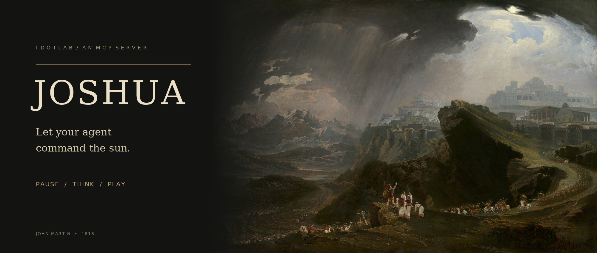

# Joshua



<sub>Artwork: John Martin, *Joshua Commanding the Sun to Stand Still upon Gibeon* (1816), National Gallery of Art.</sub>

An MCP server that lets an agent play a Windows game turn by turn. The game is
held still while the model thinks, runs only while the model's input plays, then
is held again and returns a screenshot. Slow reasoning stops mattering; being bad
at the game still does.

**Experimental.** Pause-key mode has played real games: two DOS games in
DOSBox, including a 3D sword fight, a motorcycle ride in a GTA IV episode
started through Steam, and walking and looting in Factorio. Freeze mode has
never run against a real game. See [docs/STATUS.md](docs/STATUS.md) for what is
and is not verified.

## Requirements

- Windows 11, in a logged-in desktop session (the game takes screen and focus).
  Only `"hold": "freeze"` uses Windows 11 features; Windows 10 is untested.
- Python 3.10 or newer (only 3.13 has been tried); no packages

## Setup

There is nothing to install or build. Get the code:

```powershell
git clone https://github.com/tdotlab/joshua.git
```

In the `joshua` folder, copy `games.example.json` to `games.json` and replace the
examples with the games the agent may play. Each entry says how the game is
[held still](#holding-the-game-still); for most games that means naming its pause
key. Then register the server with your MCP client, using the real path.

Claude Code:

```powershell
claude mcp add --scope user joshua -- python C:\path\to\Joshua\src\serve.py
```

Codex:

```powershell
codex mcp add joshua -- python C:\path\to\Joshua\src\serve.py
```

Any other client that runs stdio MCP servers on the same machine uses the same
command. For an agent on another machine, see below.

## Playing from another machine

Joshua can serve an agent elsewhere on your Tailscale network. The game, screen
and keyboard are still this PC's, so it has to be logged in and unlocked.

On the PC with the games:

```powershell
python C:\path\to\Joshua\src\serve.py --http
```

It listens on this PC's Tailscale address, port 8737, until you press Ctrl+C
(`--host` and `--port` change that; only loopback and Tailscale addresses are
accepted). It prints the URL, and logs each tool call and each refused token.

Clients must send a token, which is made on the first run. This copies it:

```powershell
Get-Content "$env:LOCALAPPDATA\Joshua\token.txt" | Set-Clipboard
```

`JOSHUA_TOKEN_FILE` keeps it elsewhere. To replace it, delete the file and
restart the server.

Any MCP client that speaks streamable HTTP can use the URL with the header
`Authorization: Bearer <token>`. The connection is plain HTTP; Tailscale does
the encryption. With Hermes Agent, as the user Hermes runs as:

```bash
hermes mcp add joshua --url http://100.x.y.z:8737/mcp --auth header
```

It asks for the token without showing it and keeps it in its `.env`. Then start
a new chat or send `/reload-mcp`.

Whoever has the token and can reach the port can see and control the listed
programs. A listed program is trusted with that: if its window offers a command
line, as DOSBox does, the agent can type into it. If another machine cannot
connect, check that Windows Firewall lets Python accept connections on private
networks and that your tailnet's access rules allow it.

## One player at a time

There is one screen and one keyboard, so one game is played by one client.

- While a game is being played, other clients are refused. `list_games` still
  answers.
- This holds across processes: a second Claude Code or Codex session cannot
  start a game until the first calls `end_session` or exits, or its game closes.
- Over the network, a player who disconnects can be replaced at once, and one
  who has made no call for 5 minutes can be replaced then. The newcomer calls
  `start_game`; naming the same game carries on without restarting it.
- After 30 minutes without a call, the network server lets go of the game by
  itself. A frozen game is thawed; a paused one stays paused.
- Joshua tells clients apart by connection. A single Hermes gateway shares one
  connection between its chats, so two of its chats look like one player.

## Adding a game

List the game with its `exe` and `"hold": "none"` (add `steam_appid` for most
Steam games, [below](#steam-games)). A turn-based game is then done. For a
real-time one, ask the agent to set it up: it starts the game, uses `step` to
get into live play somewhere safe with something moving, and calls `try_pause`
with a likely key.

`try_pause` watches the picture move for a second, presses the key, watches
whether it stops (3 seconds unless asked for longer), presses again and watches
for movement. It returns the pictures, what changed and where, and the settings
that fit, for example:

```json
{"hold": "pause_key", "pause_key": "esc", "pause_ms": 500}
```

To accept them, replace the entry's `"hold": "none"` with them, then have the
agent `end_session` and `start_game`. Joshua never writes `games.json`. An agent
that can edit files on this PC could, so your approval is only a check if its
client asks before editing.

Know what the result is worth:

- A still picture is evidence, not proof. A map or inventory screen can cover a
  game that keeps running. The agent should look at the pictures.
- A picture that keeps changing can still be a held game: an animated pause menu,
  or a frame counter drawn on top. The report says where the changes were and, if
  the picture also moved after the second press, offers settings with
  `check_pause` off for when only that moved.
- A wrong key does whatever it normally does, quick-saving over a save included.
  Try keys the game's controls name, on a save you can lose.
- If you take focus or press Ctrl+Alt+F12, the trial ends without sending
  anything more, which can leave the game paused.

For `startup_ms`, an unheld game that Joshua started reports with each step how
long ago its window appeared. Set `startup_ms` past the point where the game was
first ready for the pause key.

## games.json

Only programs listed here can be started, attached to or controlled. The agent
names an entry; it cannot supply paths or arguments. The file is re-read on every
use. Set `JOSHUA_GAMES` to keep it elsewhere.

| Setting | Default | Meaning |
| --- | --- | --- |
| `exe` | required | Path to the game program. Relative paths start at the file's folder. |
| `hold` | required | How the game is held still between steps: `pause_key`, `freeze` or `none`. See below. |
| `args` | `[]` | Command-line arguments. |
| `cwd` | the exe's folder | Working directory. |
| `launch` | `true` | `false`: only attach to a copy you started yourself. |
| `steam_appid` | none | Start the game through Steam. See below. Cannot be combined with `args`, `cwd` or `"launch": false`. |
| `window_title` | none | Text the window title must contain. |
| `startup_ms` | `3000` | Time the game runs after its window appears. |
| `max_width` | `1280` | Screenshots are scaled down to this width. |
| `notes` | `""` | Controls and goals, shown to the agent. |

With `"hold": "pause_key"` only:

| Setting | Default | Meaning |
| --- | --- | --- |
| `pause_key` | required | The game's pause key, or keys pressed together: `"p"`, `"esc"`, `["shift", "p"]`. Names as in step input. |
| `resume_key` | the pause key | For games with separate pause and resume keys. Without it, the pause key is a toggle. |
| `pause_ms` | `100` | How long the key is held, and how long the game then gets to react (20 to 2000). |
| `capture` | `after_pause` | `before_pause` takes the screenshot just before pausing, for games whose pause screen hides the action. |
| `check_pause` | `true` | Warn the agent if the picture keeps changing after pausing. Turn off for games with an animated pause screen, or with a live frame counter drawn over them. |

### Steam games

Many Steam games refuse to run when their program is started directly. Give the
entry a `steam_appid` (the number in the game's store page address) and let
`exe` name the program that ends up running:

```json
"gta4": {
  "exe": "C:/Program Files (x86)/Steam/steamapps/common/Grand Theft Auto IV/GTAIV/GTAIV.exe",
  "steam_appid": 12210,
  "hold": "pause_key",
  "pause_key": "esc",
  "pause_ms": 500,
  "capture": "before_pause",
  "check_pause": false
}
```

That is what GTA IV: The Complete Edition was tried with. Its pause menu covers
the action and fades in, hence the capture and timing settings. It also needs to
run in a window: the tried setup was a `commandline.txt` beside `GTAIV.exe` with
the lines `-windowed`, `-width 1280` and `-height 720`. Esc is its pause key
only during play, so reach the game's menus with a second entry for it that has
`"hold": "none"`, then `end_session` and start the paused entry.

If that program is not already running, Joshua asks Steam to start the game,
waits up to four minutes for the program to show a window, then lets it run for
`startup_ms`. Anything Steam or a publisher's launcher asks (sign-in, updates,
terms, which version to start) is yours to answer. If the wait runs out or the
first step fails, the game is left running and calling `start_game` again
attaches to it; `end_session` can then no longer close it. Launch options go in
Steam's own settings for the game.

A slow launcher can outlast an MCP client's tool timeout (GTA IV took about
three minutes). The client then does not see the result: raise the timeout (in
Codex, `tool_timeout_sec`, 60 seconds by default), or start the game yourself
first.

### Factorio

The Steam copy, started directly, hands itself back to Steam and exits, and
Steam then asks you to approve the arguments. A `steam_appid.txt` file
containing `427520` beside `factorio.exe` stops the hand-off (a Steamworks
developer feature; delete the file afterwards if you do not want it to stay).
This entry then worked, with a `config.ini` of its own so the game did not use
your saves or settings:

```json
"factorio": {
  "exe": "C:/Program Files (x86)/Steam/steamapps/common/Factorio/bin/x64/factorio.exe",
  "args": ["-c", "C:/path/to/agent/config.ini", "--load-game", "C:/path/to/agent/map.zip",
           "--window-size", "1280x720", "--disable-audio"],
  "hold": "pause_key",
  "pause_key": "pause",
  "pause_ms": 200,
  "startup_ms": 40000,
  "capture": "before_pause",
  "check_pause": false
}
```

The `config.ini` needs `read-data=__PATH__system-read-data__` and a `write-data`
folder under `[path]`, and `full-screen=false` under `[graphics]`; make the map
with `factorio.exe -c config.ini --create map.zip`. `startup_ms` must outlast
loading (about 30 seconds the first time): a pause pressed while loading is
ignored, leaving the toggle out of step. The run used 20000, which was too short;
40000 has not been tried. The paused screen is dimmed, hence
`before_pause`. `check_pause` was off because of a live frame counter on the test
PC. A separate `config.ini` does not separate Steam Cloud: the game could still
read the account's cloud files. The test ended by killing the game, and those
files were unchanged; what a normal exit writes to them has not been checked.

## Holding the game still

**`pause_key` (preferred).** Joshua presses the game's own pause key: resume,
play the input, pause, take the screenshot. Nothing is injected or suspended, and
the game's clock stays sane because the game paused itself. The catches:

- The game must have a pause that really stops the action. Emulators and most PC
  games do; some cutscenes and menus ignore it.
- The agent cannot use that key for anything else. Pick a key, or an emulator
  hotkey, that the game does not otherwise need.
- The game runs for a moment the agent did not ask for: about `pause_ms` before
  the input and a little more after it. The reported run time includes it.
- A toggle can get out of step, for example if you pause the game yourself before
  the agent attaches. After pausing, Joshua takes a second picture
  `pause_ms` later; if the two differ, it warns the agent, which can call
  `repause`.
- The pause key is only sent while the game is in front. If you take focus
  during a step, the game is left running and the agent is told.

### DOSBox

DOSBox has its own pause hotkey, which stops the whole emulated machine, so any
game in it can be held without help from the game. Tried with DOSBox 0.73 and
0.74:

```json
"daggerfall": {
  "exe": "C:/Games/Daggerfall/DOSBox-0.74/DOSBox.exe",
  "args": ["-noconsole", "-conf", "daggerfall.conf"],
  "hold": "pause_key",
  "pause_key": ["alt", "pause"],
  "window_title": "DOSBox",
  "startup_ms": 9000
}
```

With `autolock=true` in the DOSBox config (set in both tested copies), the first
click in the window captures the mouse. After that `mouse_to` does not apply:
move with `mouse_move`, which is not one to one with screenshot pixels, so look
where the cursor landed and correct. Tell the agent this in `notes`.

**`freeze`. Untested on real games.** Suspend the whole process. In principle it
works for any game, but suspending a process does not stop Windows' clocks: a
thawed game sees all the thinking time as having passed and may skip ahead, drop
its timers or jump its physics.

Antivirus software may also object. During development, an experiment that
injected a DLL into a suspended test program made Microsoft Defender quarantine
that program. The injection code is not part of Joshua, but whether suspension
alone can set off a similar detection is untested. `pause_key` avoids the
question.

**`none`.** The game keeps running while the agent thinks. Fine for turn-based
games, puzzles and anything else that waits for input.

This project will not disguise any technique to get past antivirus software, and
you should not turn protection off for it. Never use it on online games or games
with anti-cheat.

## Tools

| Tool | What it does |
| --- | --- |
| `list_games` | The allowed games and their notes. |
| `start_game` | Start or attach, hold still, return a screenshot. |
| `step` | Let it run, play a list of timed segments, hold still, return a screenshot. |
| `repause` | Press the pause key once more, when a toggle is out of step. |
| `try_pause` | For a game listed with `"hold": "none"`: [find its pause settings](#adding-a-game). |
| `look` | The latest screenshot again. |
| `end_session` | Let go (a frozen game is thawed, a paused one stays paused); optionally close a game this session started. |

A segment is `{"ms": 300, "keys": ["up"], "buttons": ["left"], "mouse_to": [x, y],
"mouse_move": [dx, dy]}`; only `ms` is required. `mouse_to` uses screenshot
pixels, `mouse_move` is relative motion for camera control or a captured mouse.
Key names include letters, digits, `up`, `enter`, `esc`, `space`, `shift`,
`ctrl`, `alt`, `f1` to `f12` and `pause`; the full list is in
`src/joshua/timeline.py`. One step is at most 15 seconds and 60 segments.

## Behavior to expect

- Input is sent only while the game is in front. Switching away stops the step and
  releases everything held.
- Hold Ctrl+Alt+F12 during a step to stop its input. It does not end the session;
  close the MCP client or tell the agent to stop. While you hold it, the pause key
  is not sent either, so a paused game is left running.
- The server waits for you to be idle for two seconds before taking focus. The
  game stays held while it waits.
- A screenshot covers the game's drawing area only, and is skipped if the game is
  not in front or another window is over it. The corners are blacked out, because
  Windows 11 rounds them and the desktop shows through.
- Windows occasionally refuses to bring a newly launched game forward. The start
  fails, the game is closed again, and trying once more has worked.
- With `freeze`: typing into the frozen window may be delivered when it resumes,
  Windows may mark it "Not Responding" if you click it, and if the server dies,
  Windows thaws the game.
- Exclusive fullscreen captures as black: run windowed or borderless. Games
  running as administrator cannot be controlled. Keyboard and mouse only.

## Development

```powershell
python -m unittest discover -s tests -v
```

By default the tests start no game, suspend nothing and send no real input. One
group is opt-in: with `JOSHUA_LIVE=1`, the real server, over stdio and over HTTP
on loopback, plays `tests/pausebox.py`, a small Tk window that pauses with P,
using real input and screenshots. It takes the screen and keyboard for about a
minute, so leave the computer alone. Nothing is suspended.

Design: [docs/ARCHITECTURE.md](docs/ARCHITECTURE.md).

## License

[MIT](LICENSE).
